# A Sárkány szeme – kalandkönyv Videoton TV-Computerre

Ian Livingstone *A Sárkány szeme* (Eye of the Dragon) című lapozós kalandkönyvének TVC-átirata, Z80 gépi kódban:
a teljes könyv (407 fejezet, 30 rajz) lemezen (VT-DOS), és egy 48 fejezetes kazettás demó. Szabálymotor
(kalandlap, harc, próbák, tárgyak, arany, bolt, kulcsok), zene, mentés és visszatöltés; fekete betű fehér lapon, mint egy nyomtatott könyvben.

**AI-jal készült:** a program, a szabálykód és a zene Claude (Anthropic), a 30 rajz ChatGPT munkája (az eredeti
illusztrációk nyomán, új rajzként); a címlapon is szerepel.

> **Szerzői jog:** a könyv eredeti szövege és illusztrációi a szerzőé és a kiadóé; a magyar fordítás a Zagor.hu munkája.
> Ez a tároló magáncélú, nem nyilvános; a szöveget és a képeket ne tedd közzé engedély nélkül.
> A motor, a fordító, a szabálykód és a zene saját munka; a rajzok ChatGPT-vel készültek.

## Gyors indítás
| Fájl | Mire |
|---|---|
| [`lemez/sarkany.dsk`](lemez/sarkany.dsk) | **a teljes könyv**, 720K-s VT-DOS lemezkép (TVC 64K/64K+ + HBF/lemezvezérlő). Indítás: `LOAD "KALAND"` |
| [`lemez/kaland.cas`](lemez/kaland.cas) | kazettás demó (48 fejezet, 3 rajz), `LOAD` után önindító |

Billentyűk: **Szóköz/Tűz** lapozás és választás, **nyilak** a menüben, **Esc** kilépés a BASIC-be.
A menüben mindig ott a **Lap** (kalandlap) és az **Ital**. Lemezen a kalandlapon **Fel** = mentés,
**Le** = visszatöltés; a címlapon **Le** = a mentett játék. Tesztelve: Ep128web, és teki rtvc emulátora valódi VT-DOS-szal.

## A motor

Videoton TVC 64K, 2 színű mód (512×240), **fekete a fehéren** (paletta: $60 = $55 fehér háttér, $61 = $00 fekete tinta, fehér keret; a rajzok fekete vonalai feketék, a papír fehér), Z80 gépi kód, `10 PRINT USR(6659)` betöltővel, automatikus indítással.
A hardverkezelés a BLOKK 3D konvencióit követi: lapozás `$B0`/`$90`/`$70`, billentyűzet 8. és 7. sor,
képkocka-szinkron a `$59`-es porton, kilépés a ROM-másolatok visszaírásával és `RST $30 / $05`-tel.

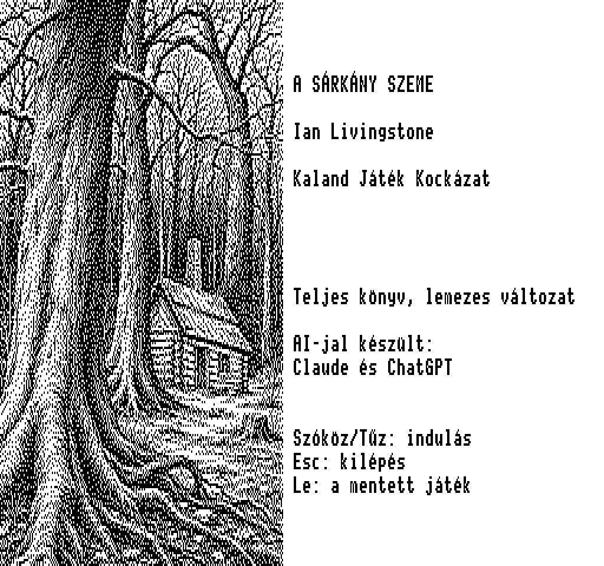

### A 30 rajz a TVC-n
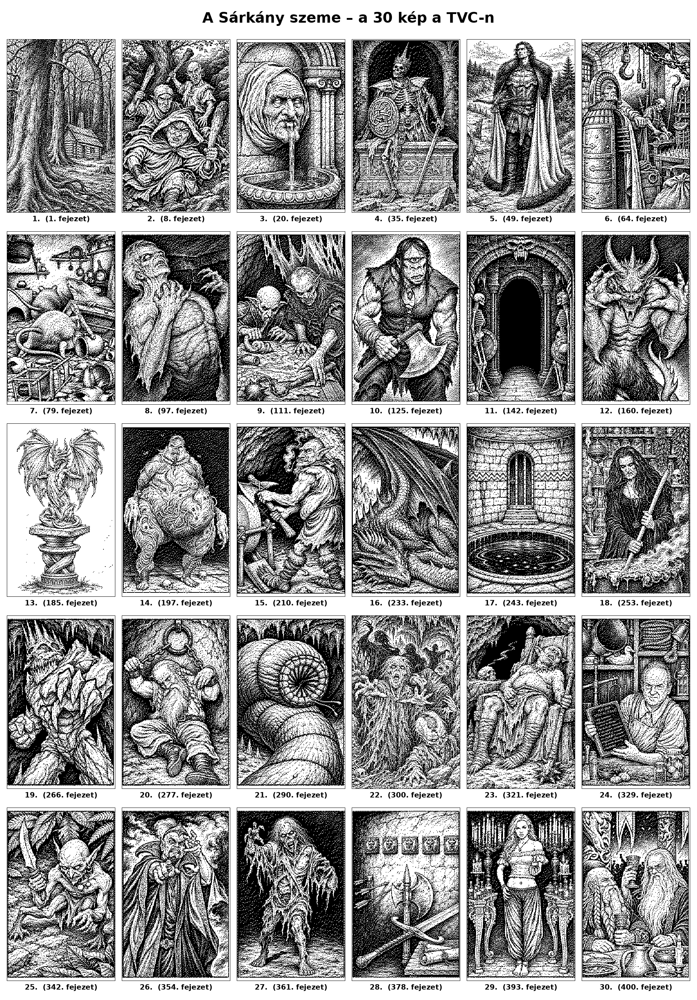

Az eredeti, nagy felbontású rajzok: [`kepek_eredeti/`](kepek_eredeti/) (`01.png`…`30.png`).

## Mit tud
- **Rajz** a képernyő bal felén (30 bájt × 240 sor = 240×240 pont), **szöveg** a jobb felén: 33 oszlop, a könyv szövege 21 sor + üres sor + 2 állapotsor, saját 8×10-es font magyar ékezetekkel.
- Szótördelés; ha a fejezet nem fér egy oldalra: „--- tovább: Szóköz ---”.
- A fejezet végén a **„Lapozz:”** menü: a célok közül kurzorral (bal/jobb/fel/le) választasz, Szóközzel vagy Tűzzel lapozol.
- Halál / vég esetén „VÉGE. Szóköz: újra”, Esc bármikor kilép a BASIC-be.
- Új rajz csak akkor töltődik, ha a fejezetnek van saját rajza; addig az előző marad.
- A szöveg fejezetenként tömörítve van (BPE + kanonikus Huffman); a kicsomagoló közvetlenül font-indexet ír a pufferbe.

| | |
|---|---|
| 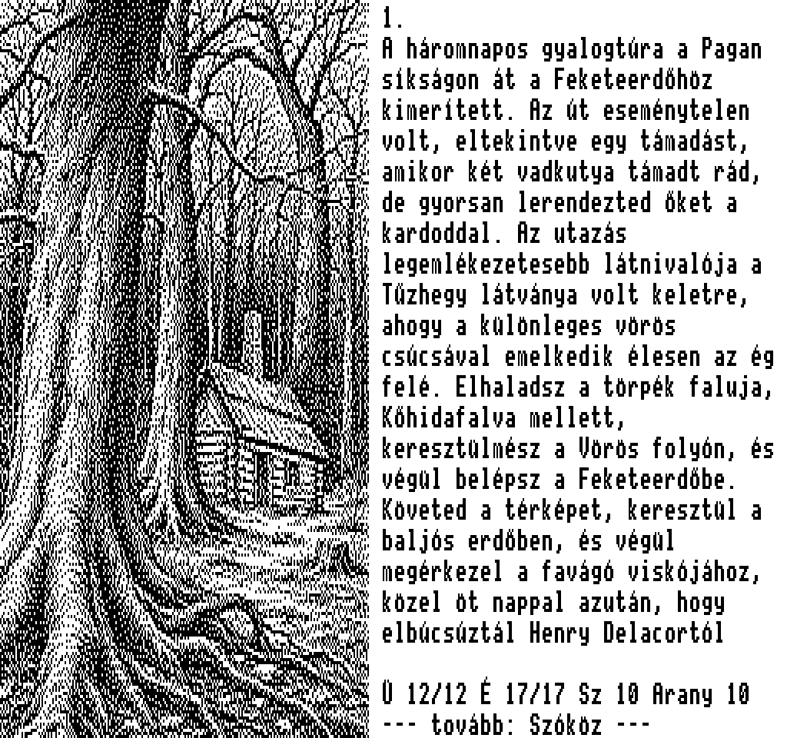 | 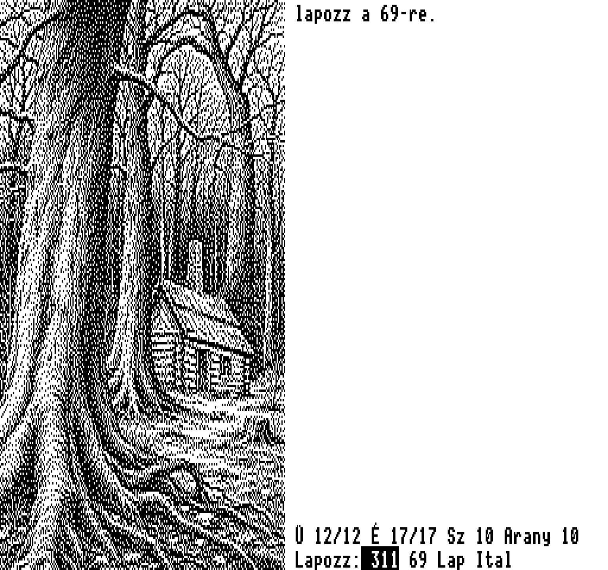 |
| 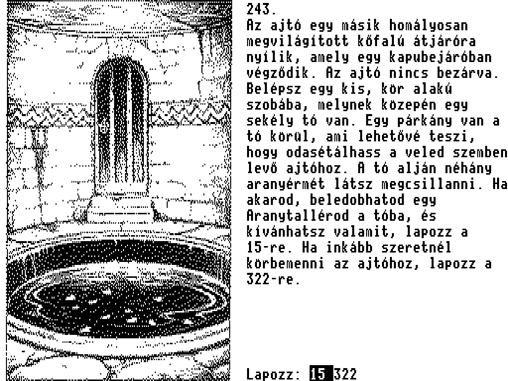 | 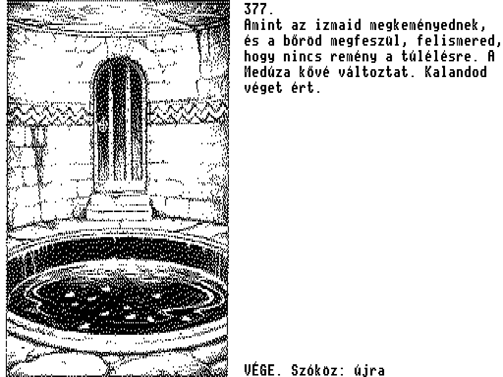 |

## Játékszabályok (szabaly.asm + rules.py)
- **Kalandlap**: új játéknál kockadobás (ÜGYESSÉG 1d6+6, ÉLETERŐ 2d6+12, SZERENCSE 1d6+6), a három varázsital
  egyikének választása (2 adag). Indulás: kard, pajzs, Henry Delacor emeráldja, 10 aranytallér.
- **Állapotsor** a menü fölött: `Ü 7/7 É 20/20 Sz 9 Arany 10`; a menüben mindig ott a **Lap** (kalandlap: pontok,
  ital, tárgyak) és, amíg van belőle, az **Ital**.
- **Harc** a könyv szabályai szerint (2d6 + ÜGYESSÉG, 2 sebzés), körönként Szóköz/Tűz; több ellenfél egymás után vagy
  egyszerre (79). Különleges harcok: Littlebig második támadása (35, 87, 137, 266, 269), a szörny kettős támadása
  (12, 57), találathatár (12, 57: 3 marás; 362: Ghoul 4 találat = halál), módosított sebzés (35, 195, 266),
  ÜGYESSÉG-levonás (97, 172), első kör dönt (360), két megnyert kör (49), három kör túlélése (313), a Szellem (27),
  menekülés hat kör után szerencsével (107), gázfelhő (137, 269), vámpírdenevér (95), kris kés (195), patkányraj (182).
- **Szerencsepróba** (2d6 ≤ SZERENCSE, utána −1), **ügyességpróba**, kockadobásos sebzés, húslárvák (143/271/63).
- **Tárgyak és jelzők** (55 tárgy + 3 rejtett jelző, pl. megetted-e a pasztát): a „Ha van…/Ha nincs…” lapozási
  célok automatikusan szűrődnek, csak a lehetséges célok választhatók.
- **Arany**, fizetés (110, 334→379, 15, 39, 96), **bolt** (329: Kréta…Aszalt gomba; 11: Pia italai; 196: festmény).
- **Kulcsok**: a megtalált számozott kulcsok a 227/175-ös fejezetben menüpontként jelennek meg; a doboz kinyitása után
  a kulcs elfogy. Véletlen tárgyvesztés (94: 1, 264: 1d6 tárgy; az emeráldokat nem viheti el).
- Halál (ÉLETERŐ 0, vagy véget érő fejezet): „Kalandod véget ért” → új játék; a 400-asnál „GYŐZTÉL!”.
- Visszalapozáskor a fejezet nyereségei (pont, arany, tárgy) nem ismétlődnek, a veszteségek igen.

A szabályok forrása a `rules.py`: fejezetenként egy rövid műveletlista (198 fejezet, a teljes könyv), amit a build
bájtkóddá fordít és a fejezet ugrótáblája mögé tesz (a teljes könyvre kb. 2,1 KB). Ellenőrzés: `python3 rules.py`
(minden cél valóban a fejezet lapozási célja-e, és minden harc szerepel-e).

| | |
|---|---|
| 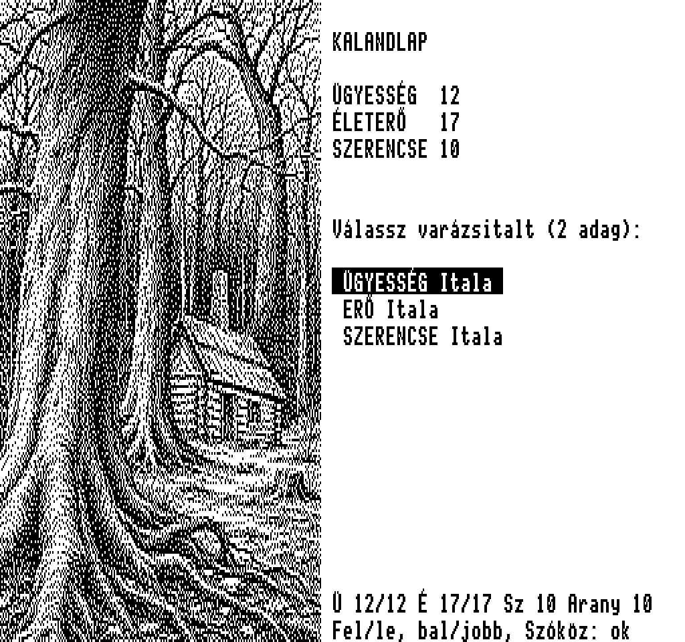 | 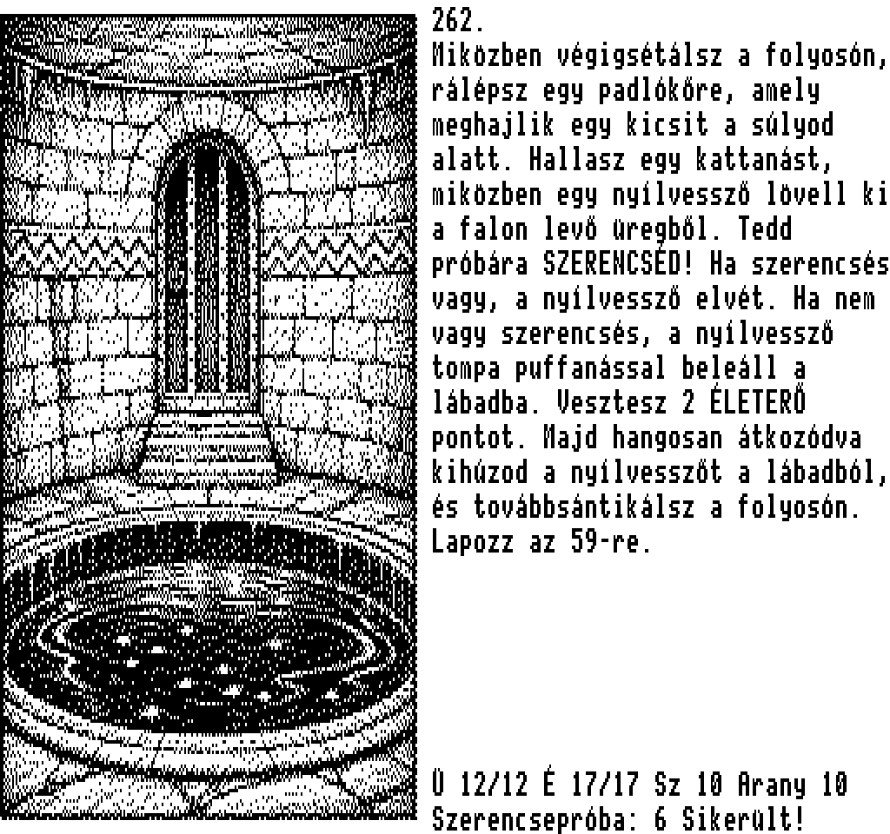 |
| 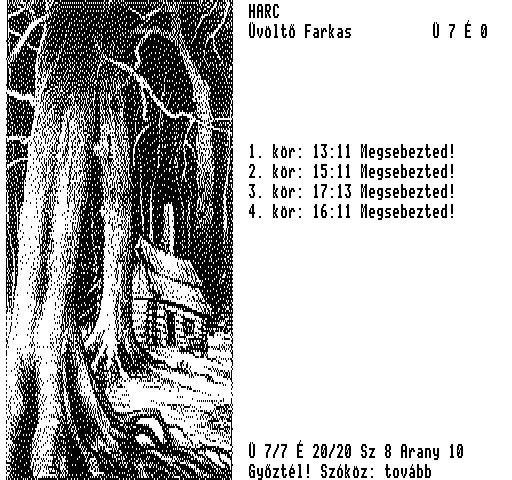 | 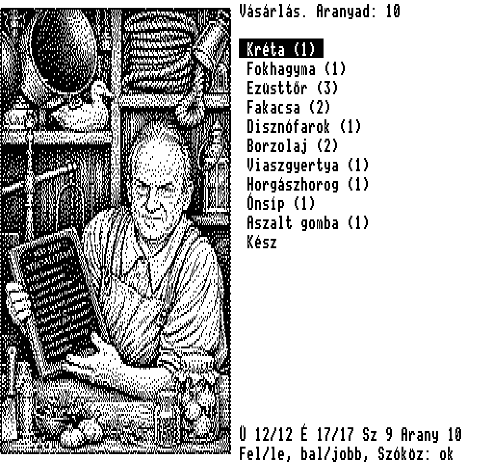 |

## Színek és elrendezés
Fekete betű és rajz fehér lapon, fehér kerettel; a színek nem változtathatók. A könyv szövege a 21. sorig
tart: alatta mindig marad egy üres sor, és csak utána jön az állapotsor és a menü. (A motor könyvenként
állítható: `build.py` → `meta`: `paper`, `ink`, `border`, `fixed_palette`, `text_gap`, `img_invert`. A korábbi
zöld-fekete, színválasztós változathoz: `meta = {}`.)

## Zene
Saját szerzemények a TVC egyszólamú hanggenerátorára (`zene.py` → `zene.inc`, lejátszó: `zene.asm`):
címzene (lassú ballada, D dór, ismétlődik – a címlapon és a kalandlap készítésekor), harci zene (gyors,
A moll, ismétlődik), szignál a megnyert harcra, a halálra és a 400-as győzelemre. A lejátszó képkockánként
lép (a billentyűre várás közben), a hangok rövid lecsengést kapnak; lemezolvasás közben elhallgat.
Hangmagasság: `f = 195312,5 / (4096 − n)` Hz, `$04/$05` osztó, `$06` 2–5. bit hangerő.
Előhallgatás: `docs/zene_elohallgatas.wav` (az összes dal, a `zene.py` utánzata),
`docs/cimzene_rtvc.wav` (a címzene az rtvc emulátor hangkimenetéről).

## Teljes könyv lemezen (VT-DOS, HBF kártya)
```
SJASMPLUS=/út/a/sjasmplus python3 build.py --disk        # -> build_disk/sarkany.dsk (720 KB) és build_disk/lemez/*.CAS
```
Indítás TVC 64K + HBF + VT-DOS alatt: `LOAD "KALAND"` (önindító).

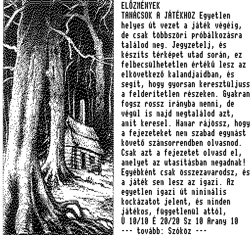

- **Mind a 407 fejezet, mind a 30 rajz**, és elöl az **Előzmények** (a könyv tanácsai és háttértörténete) két részben.
- A gépen maradó rész (`KALAND.CAS`, 17 KB): kód, font, kicsomagoló-táblák, minden fejezet ugrótáblája és szabálya.
- A szöveg 22 db 4 KB-os blokkban (`T00`…`T21.CAS`), bejárási sorrendben csoportosítva, hogy az egymás után
  olvasott fejezetek többnyire ugyanabban a blokkban legyenek; a memóriában **4 blokk** fér el ($5D00-tól),
  és csak hiánynál olvas a lemezről. A rajzok `I01`…`I30.CAS` (7200 bájt), betöltés a $A3E0-s átmeneti helyre.
- A lemezkezelés a VT-DOS kazettás felületén át megy, ahogy teki *Laser Squad* TVC-átiratának lemezes betöltője
  (`teki/tvc-ports`): `RST 30h` + `D3h` (megnyitás, DE = név), `D2h` (blokk be, DE = cél, BC = hossz), `D4h`
  (lezárás); előtte `1705h = D0h`, `0B6Bh = 0`. A hívás idejére a verem $C000 alá kerül (a ROM a 3. lapra
  SYS-t tesz és megszakítást engedélyez), a cél legfeljebb $BFFF; utána DI, `MAP_LOGIC`, a videomód, a paletta
  és a keret visszaállítása. A fájl elején a 16 bájtos programfejlécet átolvassa.
- **Mentés és visszatöltés** (egy mentés, `MENTES.CAS` a lemezen): a kalandlapon (menü: *Lap*) **Fel** = mentés,
  **Le** = visszatöltés; a címlapon **Le** = a mentett játék folytatása. A mentés a teljes állást tartalmazza
  (fejezet, menü, rajz, pontok, ital, tárgyak, arany, bejárt fejezetek); az új mentés felülírja a régit.
  A VT-DOS kimenete: `1705h = 50h`, `53h` létrehozás, `51h` a 16 bájtos fejléc karakterenként, `52h` blokk, `54h` lezárás
  (a Laser Squad mentése alapján). Rossz vagy régebbi programváltozat mentését nem tölti vissza.
- Kilépéskor (Esc) az `1705h` és `0B6Bh` rendszerbájt visszakapja az eredeti értékét (különben a BASIC
  „System error 233”-mal állna meg).
- Lemezhiba esetén: „Lemezhiba: <kód> Szóköz: újra”. Olvasás közben a keret kék.
- A billentyűzetsor kiválasztásakor a `$03` port felső fele (a bővítőhely-választás, ezen át éri el a ROM a
  HBF kártyát) a ROM másolatából (`$0B11`) megmarad. Az első lemezes változat ezt nullázta, és a VT-DOS-hívás
  üres bővítőhelyre ugrott (fehér képernyő). A szimulátor `DISKDIR` mellett ezt is ellenőrzi.

Teszt: a `harness/tvcsim` `DISKDIR=<mappa>` mellett a `RST 30h / D3,D2,D4` hívásokat a mappa `.CAS` fájljaiból
szolgálja ki, és ellenőrzi a fenti feltételeket (verem, célcím, lapozás, 1705h); kb. 31 KB/s olvasási időt számol.
```
CAS=build_disk/lemez/KALAND.CAS DISKDIR=build_disk/lemez BUILD=build_disk python3 fuzz.py 1 2500
```
A `fuzz.py` véletlen billentyűzéssel kb. 18 perc játékot futtat (öt különböző kezdőértékkel hiba nélkül,
200+ lemezolvasás), a `checkscripts.py` a lefordított szabálykódot ellenőrzi a binárisban.

**Valódi VT-DOS alatt is kipróbálva**, teki rtvc emulátorában (TVC 1.2 + HBF + VT-DOS 1.2, `harness/rtvc/`):
címlap, kalandlap, előzmények, fejezetek, rajzok, harcok; négy hosszú véletlen futás hiba nélkül.
Ott derült ki, hogy a VT-DOS a megszakítás-kezelővel együtt **194 bájt** vermet használ: az első lemezes
változat 160 bájtos verme alatti változók (köztük a mentett SP) felülíródtak, és a második betöltésnél a
program elszállt (fehér képernyő). Most 768 bájt a verem, és a változók a verem fölött vannak; a `tvcsim`
pedig minden lemezhíváskor 400 bájtot szemetel a verem alatt, így ez a hiba ott is kijönne.

## A demó tartalma
Egy CAS legfeljebb $19EF–$BFFF-ig tölthető (kb. 42 KB), ezért a demóban:
- **48 fejezet** – az 1. fejezettől szélességi bejárással elérhetők (lista: `build/info.json`); a szabálymotor
  kb. 3 KB kódja miatt 27-tel kevesebb fér be, mint a szabályok nélküli változatba,
- **3 rajz**: az 1., a 243. és a 329. fejezeté,
- a többi fejezetre lapozva: „Ez a fejezet ebben a demóban nem szerepel.”, és vissza az 1-re.

A kód a kicsomagolóval és a szabálymotorral együtt kb. 4,4 KB ($1A03–$2B1C); a többi tábla, font és adat.
Szabad hely: 250 bájt.

## Sebesség (tvcsim, 3,125 MHz)
Egy fejezet megjelenítése (kicsomagolás + képernyőtörlés + kiírás) átlagosan **0,42 s** (1,32 millió ciklus),
a leghosszabbaknál (1200+ karakter) kb. 1 s. Rajzváltás: +0,1 s.

## Fordítás
Kell: Python 3 (Pillow, NumPy) és [sjasmplus](https://github.com/z00m128/sjasmplus). A tárolóból fordított
lemezkép és CAS bájtra azonos a `lemez/` mappában lévőkkel.
```
SJASMPLUS=/út/a/sjasmplus python3 build.py [--tokens 512] [--images 3] [--include 227,14,143]   # -> build/kaland.cas
# (sjasmplus kell: SJASMPLUS=...; az --include fejezetei mindenképp bekerülnek – teszthez)
```
A build a `konyv/sarkany_szeme.json`-t (lektorált szöveg) és az `ill/` rajzait használja,
és bináris kereséssel annyi fejezetet tesz a demóba, amennyi befér.

## Teszt
```
gcc -O2 -I<z80-mappa> -o harness/tvcsim harness/tvcsim.c <z80-mappa>/z80.c
python3 mktest.py 377            # útvonal az 1-től a 377-ig, a "tovább"-okat a tördelés modelljéből számolja
./harness/tvcsim build/kaland.cas test_route.txt 1200
```
A `harness/tvcsim.c` a BLOKK 3D tesztkörnyezete, kiegészítve a 2 színű mód képmentésével
(bájtonként 8 pont, bit7 = bal szélső, a bit a palettaindex: 0 → $60, 1 → $61).
Mérés: `-DPROFILE` fordítással (OUT $FE jelölők).

A szabályok tesztjei: `play.py` (forgatókönyv-író: billentyű, várakozás, kép, poke a szimbólumtáblából) és a
`t1.py`…`t7.py` (kalandlap, harcok, bolt, próbák, kulcsok, húslárvák, patkányraj, tárgyvesztés, halál).
A kulcsos, lárvás stb. fejezetek egy `--include`-os tesztbuildben vannak: `BUILD=build_t python3 t5.py`.

## Fájlok
- `kepek_eredeti/` – a 30 új, feljavított kép eredeti méretben (`01.png`…`30.png`, sorrendben a `kepek_feljavitasra/` listája szerint), és az áttekintésük a TVC-n
- `ill/` – a lemezre kerülő képek (a 23. a fehér margó és a keret nélkül)
- `kepek_feljavitasra/` – a régi, könyvből kivágott 30 kép (ezekből készültek az újak), leírással
- `lemez/` – a kész lemezkép és a kazettás demó
- `konyv/` – a könyv szövege: `sarkany_szeme.json` (fejezetek, lapozási célok, előzmények), `sarkany_szeme_lektoralt.txt`
  (olvasható, lektorált szöveg), `README_szoveg.md` (a szöveg kinyerése és javítása)
- `eszkozok/` – `encode.py` (BPE + Huffman tömörítő), `test_decoder.py` + `z80mini.py` (a Z80-as kicsomagoló
  ellenőrzése), `tvcgfx.py` (képátalakítás a TVC 2 színű módjára)
- `docs/` – képernyőképek és a zene előhallgatása
- `kaland.asm` – a motor (sjasmplus), `szabaly.asm` – a játékszabályok, `lemez.asm` – VT-DOS betöltés és blokk-gyorsítótár,
  `decoder.asm` – a kicsomagoló
- `rules.py` – a szabályok fejezetenként, tárgylista, fordító
- `build.py` – font, tömörítés, demó-részhalmaz, rajzok, `data.inc`, fordítás, CAS
- `font.py` – a 8×10-es font (saját tervezés), `mkcas.py` – CAS csomagoló (BLOKK 3D)
- `img_sections.json` – rajz (PDF-oldal) → fejezet hozzárendelés (a rajz helyéből, közelítő)
- `harness/` – tesztkörnyezet, `tdocs.py` – a `docs/` képernyőképei, `mktest.py`, `test_ut_377.txt`

## Egyszerűsítések, hiányzik még
- Harc közben a szerencse nem használható a sebzés módosítására; a kettős marás találathatára a kör végén számít.
- A „Ha még nem tetted volna” kizárásokat nem követi (a nyereség viszont nem ismétlődik).
- A kalandlap legfeljebb 26 tárgyat mutat (két oszlopban, 16 betűre vágva).
- A szalagos demó 48 fejezetet tartalmaz; a teljes könyv a lemezes változatban van.

## Más könyv ugyanezzel a motorral
A motor könyvfüggetlen: a `build.py --book <mappa>` egy másik könyvet fordít (book.json, rules_book.py, ill/,
img_sections.json). Így készült a saját kalandkönyv, **A Varjútorony ura** (413 fejezet, 72 kép):
[Catpool72/varjutorony-tvc](https://github.com/Catpool72/varjutorony-tvc). A könyvenként állítható beállítások
(`meta`): `ink`/`paper` (alapszínek), `img_invert` (a rajzok megfordítása), `fixed_palette` (nincs színváltás),
valamint a szabályokban `('vis', N)` – jártunk-e már az N. fejezetben – és `'rev'` – ebben a fejezetben jártunk-e már.
