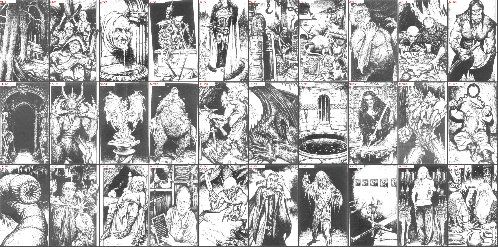

# A Sárkány szeme – a 30 kép feljavításra

A lemezes változat (`lemez/sarkany.dsk`) mind a 30 képe, a könyvből kivágott, szürkeárnyalatos eredetiben.
A fájlnév: `sorszám_fejezetNNN.png` – a szám az a fejezet, amelyiknél a kép megjelenik.

## Kérés a képalkotó MI-nek (javaslat)
> Improve this scanned black-and-white gamebook illustration: keep the exact composition, characters and
> pose; clean pen-and-ink line art, crisp cross-hatching, pure black ink on white paper, no grey wash, no
> colour, no text added, portrait format (about 5:8).

- **Fekete tus fehér papíron** legyen, mint az eredeti: a TVC-n most is fekete tintával, fehér lapon jelennek meg.
- Álló formátum, kb. **5:8** arány (pl. 640×1024 vagy nagyobb). Más arányt is elfogad, de a széleiből vág.
- A TVC-n a kép 240×240 képpont (2 szín, raszterezve): a túl apró részletek elvesznek, a határozott,
  kontrasztos vonalak jól mutatnak.

## Cserelista
| # | Fejezet | Fájl | Eredeti méret | Mit ábrázol |
|---|---|---|---|---|
| 1 | 1 | `01_fejezet001.png` | 434×733 | Erdei tisztás vén fákkal, a háttérben faház |
| 2 | 8 | `02_fejezet008.png` | 459×737 | Rablók támadása bunkókkal és tőrrel |
| 3 | 20 | `03_fejezet020.png` | 434×731 | Csuklyás vénasszony arca egy kút (szökőkút) fölött |
| 4 | 35 | `04_fejezet035.png` | 489×760 | Csontváz király koronával, pajzzsal, kőkoporsón ülve |
| 5 | 49 | `05_fejezet049.png` | 439×651 | Prémgalléros, köpenyes vadász számszeríjjal, erdei háttér |
| 6 | 64 | `06_fejezet064.png` | 437×735 | Kínzókamra: vasszűz, kampók, láncok, egy alak |
| 7 | 79 | `07_fejezet079.png` | 452×743 | Romos konyha óriáspatkányokkal |
| 8 | 97 | `08_fejezet097.png` | 459×736 | Torz, kopasz, sebhelyes élőhalott |
| 9 | 111 | `09_fejezet111.png` | 437×738 | Két gonosz figura (ork, gnóm) egy asztal fölött, buzogány |
| 10 | 125 | `10_fejezet125.png` | 452×706 | Félszemű óriás (küklopsz) bárddal |
| 11 | 142 | `11_fejezet142.png` | 437×737 | Koponyás kőkapu, két oldalán csontváz őrök |
| 12 | 160 | `12_fejezet160.png` | 466×733 | Szarvas démon kitárt karmokkal |
| 13 | 185 | `13_fejezet185.png` | 443×740 | Sárkányszobor talapzaton (a Sárkány szeme) |
| 14 | 197 | `14_fejezet197.png` | 458×716 | Hájas, csápos szörny |
| 15 | 210 | `15_fejezet210.png` | 433×712 | Barlangtroll fejszével |
| 16 | 233 | `16_fejezet233.png` | 435×735 | Alvó sárkány pikkelyes feje |
| 17 | 243 | `17_fejezet243.png` | 437×735 | Kerek terem vízzel teli medencével, ajtó a háttérben |
| 18 | 253 | `18_fejezet253.png` | 432×730 | Hosszú hajú boszorkány üst fölött, varázskellékek |
| 19 | 266 | `19_fejezet266.png` | 451×729 | Kristályokból álló szörny |
| 20 | 277 | `20_fejezet277.png` | 441×656 | Megláncolt öreg törp |
| 21 | 290 | `21_fejezet290.png` | 435×738 | Óriás féreg/hernyó szája |
| 22 | 300 | `22_fejezet300.png` | 460×734 | Élőhalottak tömege barlangban |
| 23 | 321 | `23_fejezet321.png` | 479×713 | Ork trónon ülve, buzogánnyal |
| 24 | 329 | `24_fejezet329.png` | 438×541 | Kocsmáros étlappal ('Mai nap specialitásai') |
| 25 | 342 | `25_fejezet342.png` | 439×738 | Görbe kardos, hegyes fülű kobold a dzsungelben |
| 26 | 354 | `26_fejezet354.png` | 437×737 | Köpenyes varázsló kinyújtott kézzel |
| 27 | 361 | `27_fejezet361.png` | 432×624 | Rongyos múmia/élőhalott |
| 28 | 378 | `28_fejezet378.png` | 446×741 | Fegyvercsapda: falból kicsapó lándzsák, kard |
| 29 | 393 | `29_fejezet393.png` | 434×685 | Táncosnő kehellyel, gyertyák |
| 30 | 400 | `30_fejezet400.png` | 436×734 | Ünneplés: törp és ősz varázsló kupával (győzelem) |

## Visszatöltés
Küldd vissza a feljavított képeket (a sorszám vagy a fejezetszám legyen a nevükben), és beteszem őket:
a megfelelő `ill/pNN.png` helyére kerülnek, és újrafordítom a lemezt.
